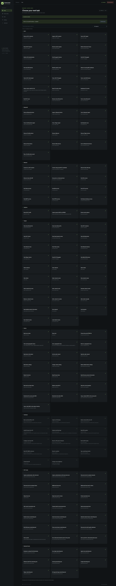

# Marauder S3 Dashboard

**A lightweight, device-hosted web interface for ESP32 Marauder on the ESP32-S3 N16R8.**

Choose a task, select a target, enter the requested settings, review, and run.
The board serves the entire website over its own Wi-Fi: no cloud account,
frontend framework, CDN, or internet connection is needed after installation.

This independent project is based on [ESP32 Marauder](https://github.com/justcallmekoko/ESP32Marauder)
v1.19.2 and targets the bare **ESP32-S3 N16R8**. Use radio and network testing
functions only on equipment and networks you own or are authorized to test.

## Features

- **Guided tasks:** searchable categories, target discovery and selection, typed
  prompts, prerequisite steps, review, progress, results, and cancellation.
- **Broad coverage:** 129 available controls and 14 explained hardware or firmware
  limitations, mapping all 63 firmware command families in this build.
- **Wi-Fi and BLE:** discovery, inspection, signal tracking, monitoring, captures,
  specialist diagnostics, and timed radio test modes.
- **Network tools:** Wi-Fi connection, LAN discovery, and service/port scans.
- **Files and targets:** capture downloads, file deletion, target selection, and
  AP/client/SSID lists saved in internal flash without an SD card.
- **Device controls:** settings, radio diagnostics, MAC controls, and an Advanced
  command reference and console for direct firmware access.
- **Recovery:** timers run on the board; closing the page does not cancel automatic
  stopping. Reopen the dashboard to monitor a running task.

<details>
<summary><strong>View the full dashboard screenshot</strong></summary>

The supplied screenshot shows the task catalog, including hardware limitations.
The published PNG contains no metadata chunks; its image data is unchanged.



</details>

## Hardware

| Component | Required configuration |
| --- | --- |
| MCU | ESP32-S3 |
| Flash | 16 MB quad flash |
| PSRAM | 8 MB OPI PSRAM, N16R8 |
| USB | Native ESP32 USB with CDC enabled |
| Radio | Built-in 2.4 GHz Wi-Fi and Bluetooth Low Energy |
| Storage | Internal SPIFFS |

This profile does not enable a display, GPS, SD card, or addressable LED.
Related controls explain their missing dependencies. CC1101 support is not included.
Other boards and PSRAM configurations require a corresponding firmware profile;
do not flash this image onto a different board.

## Build and install

### 1. Get the source and tools

Install Git, Python 3.10 or newer, [Arduino CLI](https://arduino.github.io/arduino-cli/),
and [esptool](https://docs.espressif.com/projects/esptool/en/latest/esp32s3/installation.html).
Run the following from a terminal:

```sh
git clone https://github.com/360elements360/marauder-s3-dashboard.git
cd marauder-s3-dashboard
python -m pip install esptool
arduino-cli core install esp32:esp32@3.3.11 --additional-urls https://espressif.github.io/arduino-esp32/package_esp32_index.json
python scripts/build.py
python scripts/package.py
```

Use `python3` if that is your Python executable. If Arduino CLI is not on PATH,
pass `--cli "path/to/arduino-cli"` to the build script or set `ARDUINO_CLI`.

The build script fetches pinned libraries into `.deps`, packs the website into
flash, and builds the N16R8 firmware. Internet access is needed for tool and
dependency installation. Output goes into `artifacts`; building does not flash
the board. The package script checks partition bounds, initialized OTA data,
the exact embedded dashboard, and SHA-256 checksums, then creates
`artifacts/marauder-dashboard-n16r8.zip`.

### 2. Back up and flash

Connect the board's native USB port. Find its serial port using:

```sh
arduino-cli board list
```

The examples below use `COM9`; replace it with your board's port, such as
`COM5` on Windows or `/dev/ttyACM0` on Linux. If needed, hold BOOT while tapping
RESET to enter the ROM loader. Verify the chip and flash capacity first:

```sh
python -m esptool --chip esp32s3 --port COM9 flash-id
```

Create a `backups` folder, then save the complete 16 MB flash and install the
merged image:

```sh
mkdir backups
python -m esptool --chip esp32s3 --port COM9 read-flash 0x0 0x1000000 backups/original-flash.bin
python -m esptool --chip esp32s3 --port COM9 write-flash 0x0 artifacts/esp32_marauder.ino.merged.bin
```

**The merged installation replaces existing firmware, settings, and stored files.**
Keep the backup private. For subsequent updates with this same partition layout,
write only the application at `0x10000` to preserve settings and files:

```sh
python -m esptool --chip esp32s3 --port COM9 write-flash 0x10000 artifacts/esp32_marauder.ino.bin
```

### 3. Open the dashboard

1. Open the board's USB serial console at **115200 baud**.
2. Send `dashboard` followed by a newline. It prints the Wi-Fi name, password,
   and dashboard address.
3. Join the board's `Marauder-xxxxxx` Wi-Fi network. Stay connected when your
   computer or phone reports that the network has no internet.
4. Open **http://192.168.4.1** and enter the same device password.
5. Open **Tasks**, choose a task, and follow its prompts.

The board generates its own random 16-character password and preserves it across
restarts. It prints credentials only over USB. The browser stores the password
for the current tab's session; **Lock dashboard** removes it. No device password
or saved Wi-Fi profile is included in this repository.

If opening a serial monitor leaves the board in ROM download mode, configure
DTR and RTS as deasserted before opening the port. The included device-test
helper handles this automatically.

## Radio behavior and limits

The dashboard and radio tools share the same Wi-Fi radio. Some tasks change
channels, disable Wi-Fi, or create a separate access point, temporarily interrupting
the dashboard. Guided radio tasks have a device-owned deadline of up to five
minutes; management sequences have a thirty-second execution budget.

Wait for recovery and rejoin the board's Wi-Fi if necessary. The browser reconnects
without repeating commands. **Stop** can reach the board only while the dashboard
connection is available. USB `dashboard recover` restores control; `dashboard radio`
prints radio and task diagnostics without revealing the password.

Advanced manual radio commands default to thirty seconds. Selecting **Until stopped**
can require USB recovery or a reset. Blocking upstream commands can delay recovery
until they return. A restart clears the in-memory task and does not repeat it.

Portal mode temporarily owns port 80, suspending the dashboard until cleanup.
HTML uploads are limited to 8 KiB and use bounded, authenticated chunks with
atomic replacement. Recording captures the selected radio channel and stops near
full storage. Settings and credentials are excluded from file downloads.

## Resource use

| Resource | Current build or limit |
| --- | --- |
| Website, including task catalog | 32,007 bytes gzip; build limit below 32 KiB |
| Application | 1,618,144 bytes in the validated build |
| Static RAM | 95,724 bytes in the validated build |
| Application partitions | Two 3 MB slots |
| Internal SPIFFS | Approximately 9.9 MB |
| Console ring / log response | 8 KiB / 1 KiB |
| Command queue | Four commands, at most 256 bytes each |
| HTTP headers / JSON body | 2 KiB / 512 bytes |
| Target page | 40 entries |
| Concurrency | One task, one HTTP request, at most two AP clients |

Assets and the complete catalog remain in flash. Only the requested recipe is
parsed into a bounded temporary document. Browser polling runs every two seconds,
does not overlap, and pauses when the page is hidden.

## Development and verification

```text
firmware/esp32_marauder/   Firmware and board profile
web/                     Vanilla HTML, CSS, and JavaScript
scripts/                 Build, asset generation, packaging, and test runners
tests/                   Native C++ and browser regression tests
docs/images/             Dashboard screenshot
```

Run `python scripts/pack_assets.py` after editing the web interface; the firmware
build does this automatically. Generated command/task catalogs share their source
with the firmware, keeping the UI and executor aligned.

For browser tests, install Python Playwright and Chromium:

```sh
python -m pip install playwright pyserial
python -m playwright install chromium
python scripts/test_tool_coverage.py
python scripts/test_core.py
python scripts/test_workflow_core.py
python scripts/test_tool_core.py
python scripts/test_tool_runner.py
python scripts/test_storage_core.py
python scripts/test_storage.py
python scripts/test_templates.py
python scripts/test_csi_wifi_ownership.py
python -m unittest discover -s tests -p "test*browser.py" -v
```

Native tests use GCC when available or a pinned Zig compiler through
[uv](https://docs.astral.sh/uv/). Tool-runner tests require the pinned dependencies
installed by the build script. After a firmware build, run
`python scripts/test_firmware_stack.py` to check the ESP32's actual stack frames;
on systems where the toolchain is not discovered, pass `--objdump` with its path.

Physical-device test runners are included. Read their options before running;
they can start radio tasks and create test files:

```sh
python scripts/test_device.py --help
python scripts/test_workflow_device.py --help
python scripts/test_tools_device.py --help
```

The N16R8 build has been physically checked for authentication, PSRAM, passive
Wi-Fi/BLE workflows, timed capture and download, recovery, cancellation, target
and list persistence, template upload, and browser/mobile operation. These checks
do not establish every external radio effect. Attack/spoof/advertising effects
and LAN service scans on an external network have software validation only.
Portal lifecycle and recovery were checked, but external portal-page delivery
has not been physically verified.

## License and attribution

MIT license; see [LICENSE](LICENSE). The original upstream license is also retained
in [firmware/UPSTREAM-LICENSE](firmware/UPSTREAM-LICENSE).

Based on [justcallmekoko/ESP32Marauder](https://github.com/justcallmekoko/ESP32Marauder),
v1.19.2, source commit `be4f42811538177f0f18e6ef6f5f681c297942e5`.
